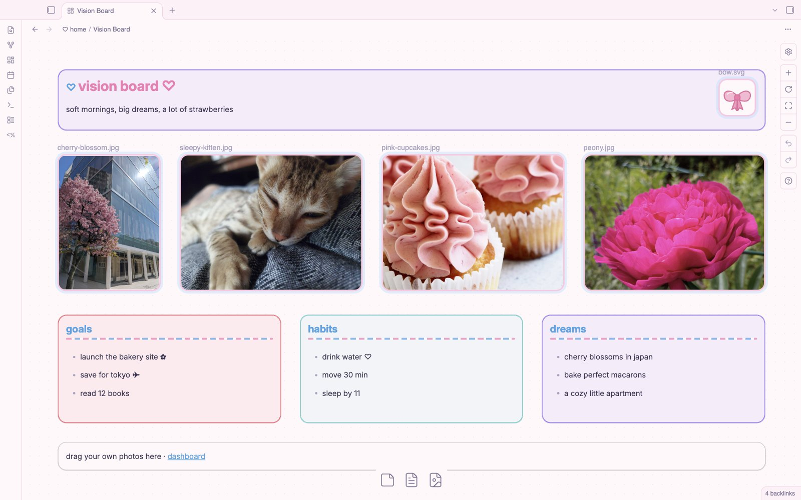
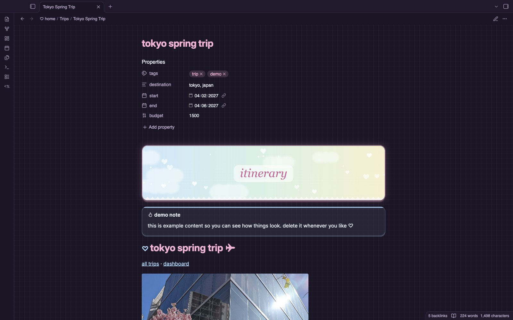
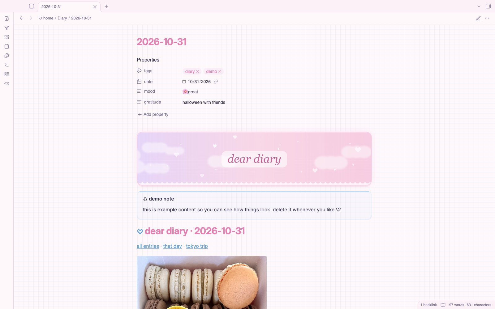
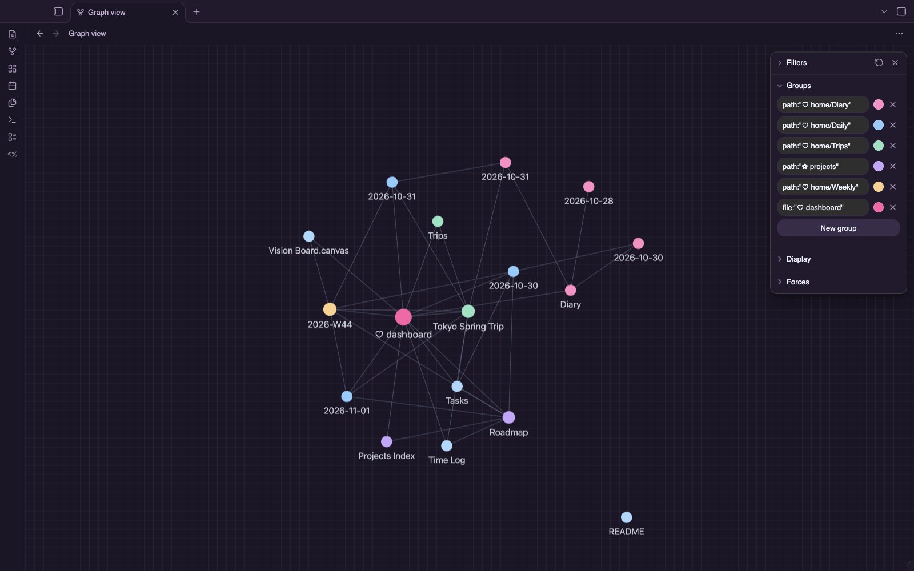

# Strawberry Cloud ♡

a soft pastel theme for obsidian: pink + baby blue, a faint pixel grid, lace and bows, candy-striped headings, heart checkboxes. light **and** dark mode, plus a hidden **hacker mode** for when you want it green on black.

## gallery
| light | dark |
|---|---|
|  |  |
|  |  |
|  |  |

**hacker mode** (style settings → strawberry cloud → hacker mode)

## features
- **light mode:** cloud white + pink
- **dark mode:** plum + pink
- rounded cards with a candy-stripe edge, lowercase headings, pink selection + cursor
- banners: put `![[image.jpg|banner]]` on the first line of a note
- stickers: `![[sticker.svg|sticker]]` floats a small sticker in the corner of a card
- `> [!grid]` callout lays out child callouts as a card grid (great for dashboards)
- extra callouts: `[!mission]`, `[!cal]`, `[!links]`, `[!photo]` (picture card, no title)
- **hacker mode** + **hide pixel grid** toggles (needs the [Style Settings](https://github.com/mgmeyers/obsidian-style-settings) plugin)

## demo vault
want the full setup (dashboard, daily notes, diary, trip itinerary, vision board, time tracker)? download `strawberry-cloud-demo-vault.zip` from the [releases page](../../releases/latest), unzip it, and open it as a vault.

## install
settings → appearance → themes → manage → search **Strawberry Cloud** → install and use.

## credits
css, banners and stickers by n16htbot. demo vault photos are public domain / CC0 from Wikimedia Commons (see the credits file inside the demo vault).

## license
MIT
