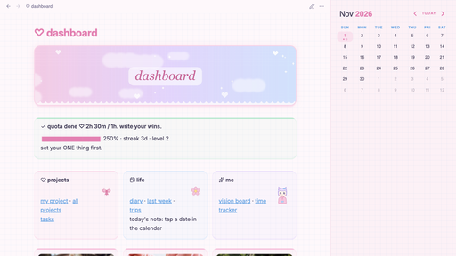
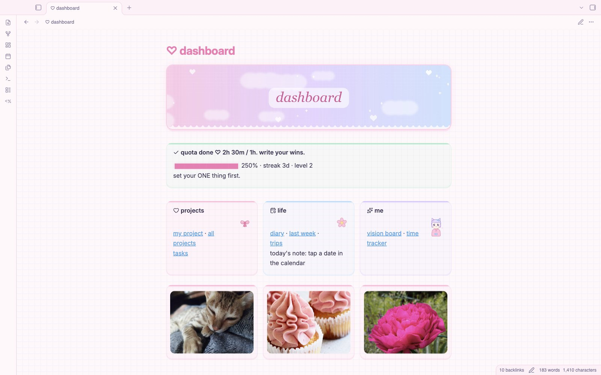
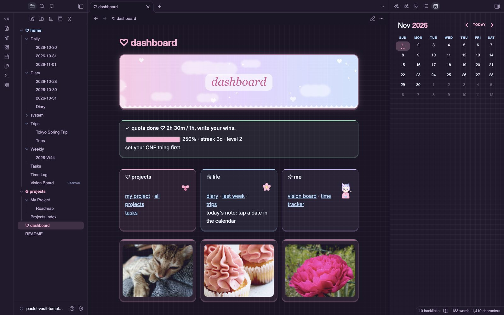
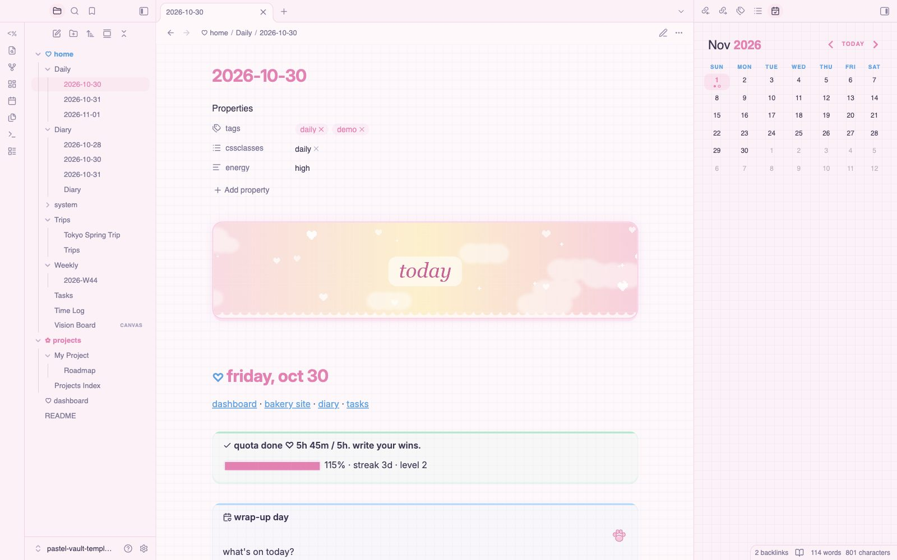
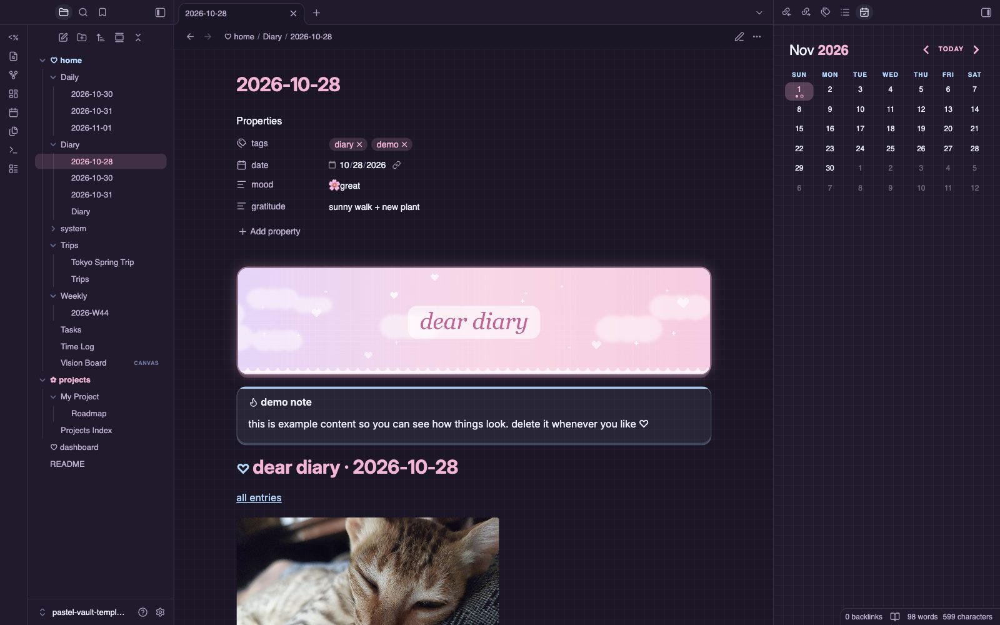
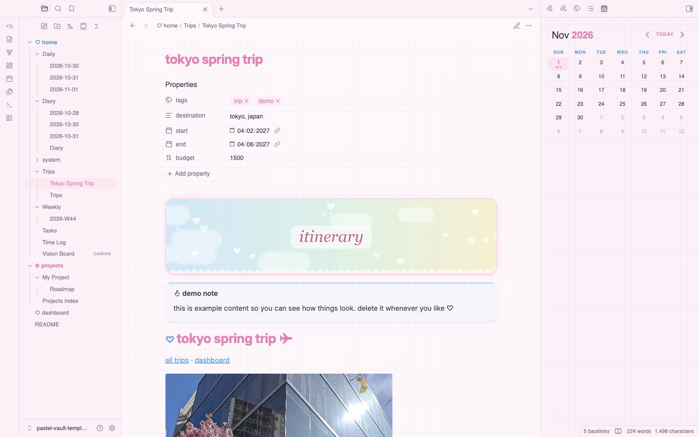
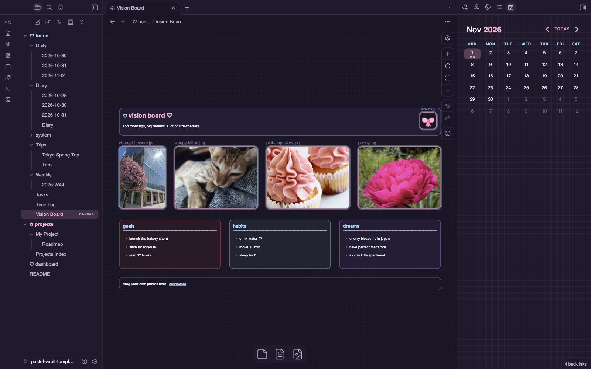
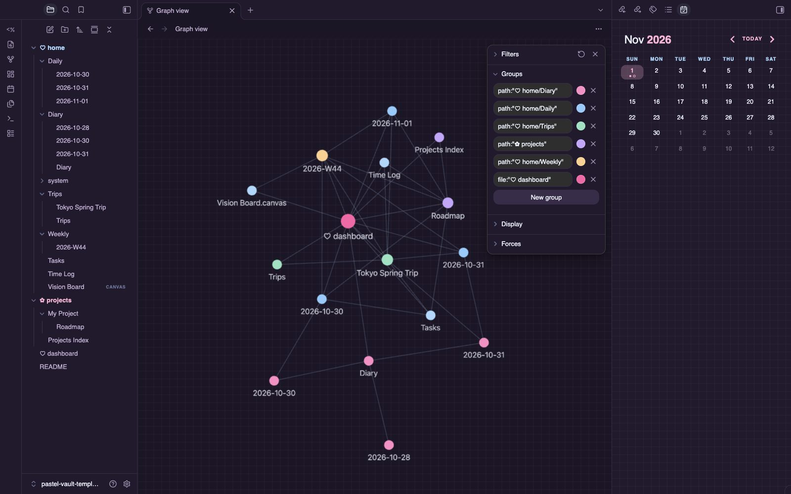
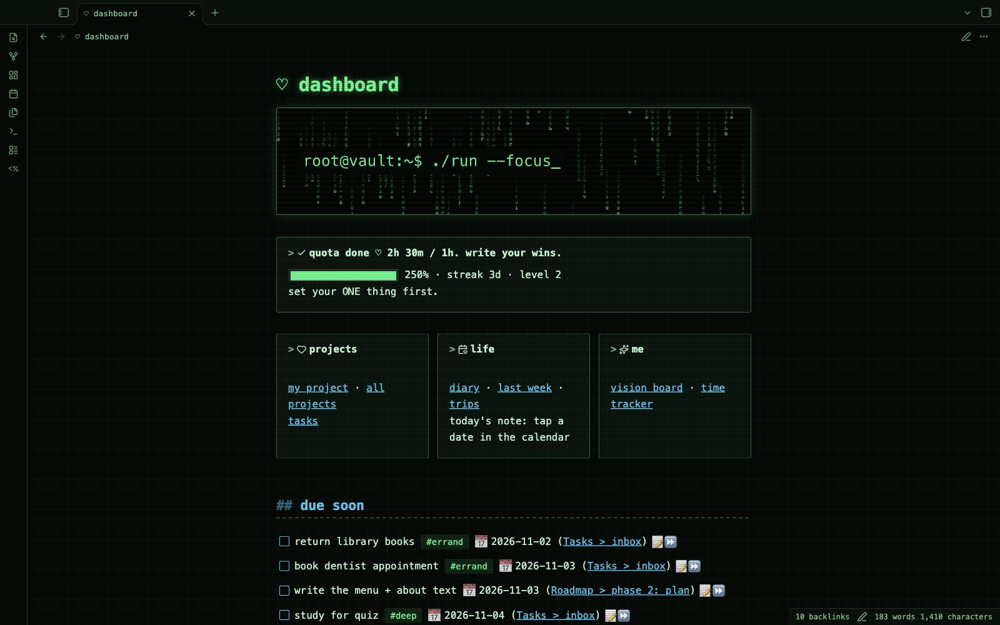

# Strawberry Cloud ♡

> strawberries, clouds and a pixel grid. soft pastel pink + baby blue in light and dark, with a secret hacker mode.

Strawberry Cloud turns your vault into a soft pastel dream. pink and baby-blue tones sit on a faint pixel grid, with lace trims, bows and candy-striped headings. cards are rounded with a candy-stripe edge, and your notes feel like strawberry milk on a cloudy morning.

## ✿ gallery
| light | dark |
|---|---|
|  |  |
|  |  |
|  |  |

**graph**: notes connect and color by type

**hacker mode** (style settings → strawberry cloud → hacker mode)

## ✿ what you get
- **light mode** in cloud white + pink, **dark mode** in deep plum + pink
- **banners:** add `|banner` to any image embed for a rounded header with a lace edge. `![[image.jpg|banner]]`
- **stickers:** add `|sticker` to float a tiny sticker in the corner of a card. `![[bow.svg|sticker]]`
- **card grids:** nest callouts inside `> [!grid]` to build a dashboard in seconds
- **cute callouts:** `[!mission]`, `[!cal]`, `[!links]` and `[!photo]` picture cards
- a styled [Calendar](https://github.com/liamcain/obsidian-calendar-plugin) sidebar: pink today, filled active day, note dots
- pink accents everywhere: links, tags, checkboxes, cursor and selection
- lightweight: one 30 KB css file, no remote fonts or images

## ✿ the secret side
flip on **hacker mode** in [Style Settings](https://github.com/mgmeyers/obsidian-style-settings) → Strawberry Cloud and it all disappears: green on black, terminal font, a code-rain banner and scanlines. same vault, other side of you. there's also a toggle to hide the pixel grid.

## ✿ free demo vault
want the full setup (dashboard, daily notes, diary, trip itinerary, vision board, time tracker)? download `strawberry-cloud-demo-vault.zip` from the [releases page](../../releases/latest), unzip it, and open it as a vault.

## ✿ install
settings → appearance → themes → manage → search **Strawberry Cloud** → install and use.

## ✿ credits
css, banners and stickers by n16htbot. demo vault photos are public domain / CC0 from Wikimedia Commons (see the credits file inside the demo vault).

## ✿ license
MIT · made with love ♡
